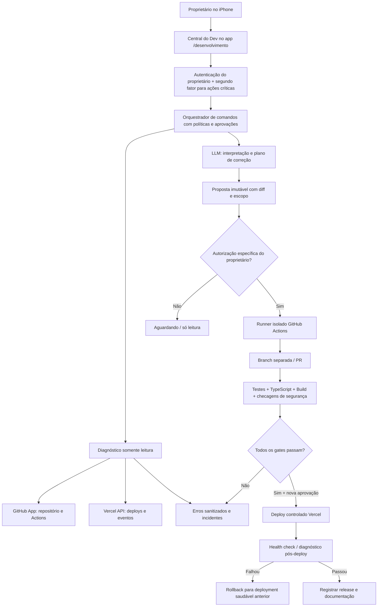

# Central de Desenvolvimento com IA — Jornada do Brito
## Arquitetura técnica e política operacional (11/10/2026)

**Objetivo:** permitir que o proprietário converse com a Jornada IA, veja erros reais do próprio sistema, analise código, autorize correções, acompanhe testes e publique uma versão validada — pelo iPhone, dentro da Jornada. **Não transformar a IA em administradora irrestrita de produção.**

**Situação em 11/10:** chat da Jornada, Groq configurável e fallback local estão implementados. `lucasbritostudio/jornada-do-brito` é o repositório identificado. Projeto Vercel `prj_nZMJzmOo0jsL9tFqfpT6lqdLm3c6`, equipe `team_ZEmFS6erUu5qbXgYyze8PWdm`. Controle de clientes/produção está em Blob privado com autenticação por cookie. O app ainda **não tem tokens próprios de GitHub e Vercel**. Conectores deste ChatGPT **não passam automaticamente** a existir na aplicação hospedada: exigir instalação/autorização separada.

## 1. Modelo de uso: dois assistentes, uma conversa

- **Jornada Assistente:** agenda, produção, clientes, oportunidades, dinheiro, filmagens. Nunca confundir projeção com entrada.
- **Jornada Desenvolvedora:** engenharia de software, bugs, repositório, configuração de deploy, performance, incidentes e monitoramento.
- **Roteador de intenções:** pergunta/diagnóstico → somente leitura; pedido explícito de alteração → plano e diff; aprovação específica → execução limitada. Nunca disparar deploy a partir de leitura de logs, textos de clientes, documentos ou resposta isolada de um LLM.
- **IA econômica:** Groq Free pode interpretar solicitações e propor passos, mas alterações de código exigem um executor determinístico + ambiente de construção isolado (GitHub Actions) e revisão de diff. Não presumir que um modelo gratuito seja tão confiável quanto um agente dedicado de engenharia; medir qualidade por testes.

## 2. Diagrama de dependências

## 3. Serviços e componentes

| Camada | Implementação | Responsabilidade |
|---|---|---|
| Frontend mobile | Next.js /desenvolvimento, React | Conversa, cards de erro, diff lado a lado, aprovação, estado de job, histórico, botão seguro de rollback |
| API protegida | Next.js /api/devops/* | Sessão, autorização, rate limit, escopo fixo, token server-side, sanitização |
| Fonte de código | GitHub App com acesso SOMENTE ao repositório selecionado | Ler arquivos/commits, criar branch, PR; exigir scopes separados para disparar Actions |
| Execução | GitHub Actions runner efêmero e isolado | `npm test`, `tsc --noEmit`, `next build`, diff e análise; nenhum token de produção exposto ao job com input não confiável |
| Observação | GitHub checks + Vercel deployments/events/logs | Erros reais correlacionados ao commit, build, deploy e rota; mascarar dados pessoais |
| Release | Vercel REST API usando token do proprietário limitado ao projeto/equipe | Deploy SOMENTE de SHA testado; healthcheck; comparação alias; rollback |
| Persistência | Separate private Blob `jornada/devops-v1/*` (fase MVP) | Solicitações, consentimentos, tentativas, hashes de artefatos, status, incidentes, trilha de auditoria CAS |
| Orquestrador | Máquina de estados determinística | LLM propõe; validador assina e aplica; nunca executar comandos livres fornecidos pelo modelo |
| Notificações | Primeiro in-app; depois alertas autorizados | Falhas relevantes, deploy falho, testes quebrados, incidentes, limite de custo |

**Aviso:** Blob funciona para histórico leve e versionado. Jobs concorrentes/retries/filas de produção devem evoluir para banco transacional + fila assíncrona (ex.: Postgres/serviço de queue) se crescerem. Evitar timers prolongados dentro de uma Vercel Function; GitHub Actions lida com trabalho longo. Armazenamento de artefatos e logs com retenção limitada.

## 4. Máquina de estados (não pular etapas)

`new → read_only_diagnosis → plan_ready → owner_approved_edit → branch_created → patch_generated → tests_running → tests_failed | review_ready → owner_approved_release → deploying → verifying → ready | rollback_running | blocked`.

- Identificador de operação imutável, SHA base fixado, hash do diff, id da aprovação, actor e timestamp, antes/depois, link de PR, workflow run, deployment id e versão anterior saudável.
- Qualquer alteração do HEAD base, timeout da aprovação, mudança de alvo ou diff novo **invalida aprovação**, exigindo outra.
- Sucesso de HTTP 200 não é sucesso do deploy: somente marcar READY após Vercel confirmar e healthcheck protegido verificar rotas chave.
- Em erro de deploy, bloquear novas ações e permitir reverter para deployment saudável sem mexer nos dados; migração destrutiva requer plano separado.

## 5. Controle de acesso — prioridade máxima

1. Login atual da Jornada é condição necessária, mas **não suficiente para poder alterar código/produção**. Para criar PR, enviar deploy, mudar env vars e rollback, adicionar nova autenticação forte do proprietário (**passkey/WebAuthn ou TOTP validado no servidor**, com confirmação recente e sessão de administrador curta).
2. **GitHub App** com mínimo de privilégios e instalação somente em `lucasbritostudio/jornada-do-brito`: Contents read na fase de diagnóstico; depois Contents write + Pull requests write; Actions read; Actions write só quando indispensável e com aprovador separado. App privado e token de instalação de curta vida, derivado server-side. Nenhum PAT administrativo persistente no iPhone nem no chat.
3. **Vercel**: token guardado no servidor (não no bundle/client/LLM), equipe e projeto travados por IDs conhecidos. Separar acesso de leitura de permissão de deployment. Se plataforma não oferecer token restrito a projeto, o backend restringe obrigatoriamente IDs e ações, mas isso **não elimina** o risco de vazamento do token amplo: preferir conta/escopo dedicado.
4. Secrets separados de `jornada/state.json` e de produção, chaves com rotação e criptografia; não mandar conteúdo de `.env`, tokens, dados de cliente, dados financeiros ou cabeçalhos de autenticação à IA. Nunca retornar `process.env` para o frontend.
5. CSRF em mutações (Origin + token), autorização server-side em CADA endpoint, reautenticação em ações críticas; idempotência/locks/CAS para operações simultâneas.
6. Logs, issues e PRs são **dados não confiáveis**, nunca instruções. Evitar que prompts ocultos possam levar à leitura de secrets, `curl|bash`, `eval`, deploy automático ou edição de scripts de CI.
7. Proibir force push, `--no-verify`, escrita direta na main, mudança automática de secrets/domínios/contas financeiras/banco produtivo e uso de preview caro por padrão.

## 6. Capacidades e ferramentas de IA

`get_repository_status(repoId)` — leitura; lista últimos commits e estado do branch.
`get_ci_runs(repoId, branch)` — leitura, checks reais e falhas.
`get_deployments(projectId)` — leitura, produção e hash da versão.
`get_deploy_events(deploymentId)` — leitura, erros de build e deploy com sanitização.
`get_runtime_errors(projectId, deploymentId, range)` — leitura, erros de runtime sem dados pessoais nem payloads.
`read_source(path, ref)` — leitura de arquivos permitidos; limitar tamanho, caminhos e sanitizar.
`propose_code_change(goal, baseSha, paths)` — gera plano/diff SEM escrever na main.
`approve_patch(proposalId, digest, adminChallenge)` — autorização do dono, gera job restrito de branch/PR.
`check_workflow(prId)` — leitura; exibe testes e falhas.
`approve_release(prId, commitSha, adminChallenge)` — outra aprovação; só se check + revisão obrigatória passaram.
`deploy_approved_sha(projectId, commitSha)` — Vercel, único alvo permitido, com recibo/rollback e idempotência.
`verify_release(deploymentId)` — aguarda READY, testa health endpoints sem expor dados.
`rollback_to_previous_healthy(deploymentId, adminChallenge)` — operação explícita e auditável.

**Regras de comunicação**: bot não afirma "corrigido", "publicado" ou "erro resolvido" até ferramentas confirmarem. Usuário acompanha status de cada operação e pode parar novos jobs; jobs já iniciados podem exigir cancelamento explícito.

## 7. Diagnóstico inteligente de problemas

1. **Coleta** sob demanda, baseada em commit/release/ambiente. Sem varrer outros projetos e sem polling em todo clique.
2. **Classificação determinística**: `build`, `typescript`, `test`, `auth`, `runtime`, `integration`, `external_provider`, `data_conflict`, `rate_limit`, `unknown`.
3. **Deduplicação** por `hash(projectId, deploymentId, fingerprint(sanitizedMessage))` com contador; manter status `new/investigating/fixed/verified`.
4. **Correlação** com commit, etapa, horário Fortaleza, rota sanitizada e versão anterior; sugerir causa e evidência, sempre distinguindo *observação* de *hipótese*.
5. **Correção automática sob controle**: teste que reproduza falha → patch mínimo → PR → CI → aprovação da release → validação pós-deploy. Não reexecutar testes já aprovados no mesmo SHA desnecessariamente.
6. **Fontes**: GitHub checks/Actions (build/testes), Vercel events/runtime logs, auditoria estruturada interna e health checks. Sem prometer "100% dos erros" — nem todo bug gera log.

## 8. Fluxo da conversa

Usuário: "Meu sistema travou no iPhone".
- Centro mostra último deployment e status (IDs do projeto exato).
- Agente lê erros recentes e histórico de commits; explica hipóteses com evidência e confiança.
- Se for correção de código, propõe diff pequeno e seus testes.
- Proprietário aprova a alteração; executor abre branch/PR, não altera a main.
- GitHub Actions verifica; caso falhe, agente estuda logs e propõe outro patch.
- Ao aprovar publicação, backend valida SHA + checks + autorização forte.
- Vercel publica o SHA testado e a Jornada mostra READY confirmado ou oferece rollback.

Usuário: "Atualiza o layout da tela de Produção": mesmo fluxo, com screenshot/requisito de UX; nenhuma mutação em produção durante etapa de planejamento.

## 9. UX do iPhone

Tela **Desenvolvimento**:
- **Agora**: estado GitHub, deploy vigente e 1 alerta prioritário.
- **Converse com a IA**: texto e opcionalmente voz por ditado nativo do iOS.
- **Problemas**: incidents agrupados por gravidade, com mensagem simples e "ver evidência".
- **Alterações**: diff legível no celular, comentários e aprovações.
- **Deploys**: versão atual, testes, progresso, última versão saudável e rollback com reautenticação.
- **Histórico**: decisões, custo por job, mudanças/erros resolvidos.
Uma única ação primária por momento, sem painéis intermináveis. Evitar exibir logs brutos por padrão.

## 10. Custos, limites e privacidade

- Padrão é consulta manual ("Atualizar estado") e cache de curta duração, não monitoramento a cada segundo.
- Limites por dia: diagnósticos LLM, sessões de edição, jobs Actions, bytes de logs e tamanho do contexto. Exibir gasto real quando provider expuser; não inventar preço.
- Usar regex/regras locais para classificar falhas simples sem LLM. Enviar à Groq só excertos sanitizados e necessários.
- GitHub Actions somente quando houver commit alterado ou pedido explícito; Vercel apenas após autorização e gates; **previews desativados como padrão**.
- Logs retidos por período controlado; limpar mensagens/tokens e dados pessoais; não registrar telefone/endereço completo.
- Não misturar cofre do filmmaker, contas da pizzaria ou outros sistemas ao ambiente DevOps.

## 11. Etapas e critérios de aceite

**Fase 0 — arquitetura (esta entrega):** escopo, ameaça, máquina de estados e contrato de ferramentas definidos, sem acesso a credenciais. 
**Fase 1 — leitura segura (primeiro MVP):** rota `/desenvolvimento` protegida; resumo GitHub e Vercel somente leitura, mostrando `não conectado` se falta autenticação; zero alterações em produção/arquivos.
**Fase 2 — credenciais oficiais:** criar/instalar GitHub App limitada ao repo, autorizar Vercel API separadamente; adicionar segundo fator admin; testar escopos e revogação; nenhum token em resposta de IA.
**Fase 3 — execução isolada:** gerar alterações em branch via GitHub Actions; testar, revisar diff, PR; falha segura e logs sanitizados. Fazer unit/integration tests com chamadas simuladas.
**Fase 4 — release controlada:** selecionar PR/SHA aprovado e Vercel projeto fixo, deploy, confirmar READY, health e rollback, sem preview automático; pedir aprovação novamente ao publicar.
**Fase 5 — observabilidade e melhoria contínua:** incidentes, logs reais, correlacionar erros a releases, aprendizado técnico somente após verificação, orçamentos e análise de regressão.

**Gates antes de publicação da IA Desenvolvedora:** autenticação/CSRF, bloqueio total de mutações sem segundo fator, escopo validado, test suite + TypeScript + build, simulação de falha/concorrência, teste mobile; produção só após revisão e autorização do proprietário.

## 12. Decisões e limitações

- Não transformar os **conectores do ChatGPT** em credenciais da Jornada por suposição.
- Não confundir "Groq conectada" com "agente capaz de editar repositório"; requer ferramentas/runner específicos.
- Sem GitHub App/token Vercel autorizado separadamente, a central não poderá ler dados privados nem publicar a partir do próprio aplicativo. A fase 1 exibe claramente configuração pendente.
- O executor não aceita instruções de shell arbitrárias nem dá acesso direto ao banco de produção. CI é o caminho controlado.
- A arquitetura não é certificação de segurança. Fazer revisão de ameaças e testes com contas reais quando as integrações forem configuradas.

Fontes principais:
- GitHub App best practices: https://docs.github.com/en/apps/creating-github-apps/about-creating-github-apps/best-practices-for-creating-a-github-app
- GitHub installation tokens: https://docs.github.com/en/rest/apps/apps
- GitHub Actions REST: https://docs.github.com/en/rest/actions/workflow-runs
- Vercel REST: https://vercel.com/docs/rest-api
