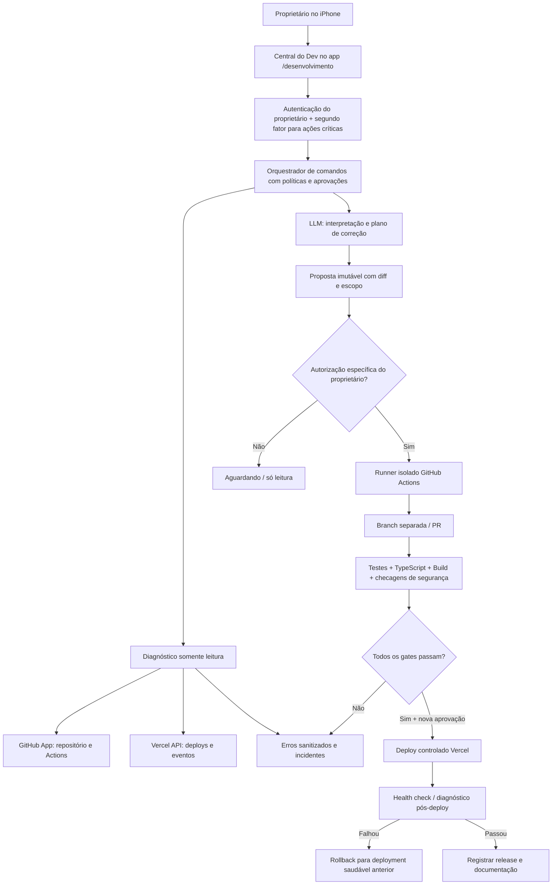

# Central de Desenvolvimento com IA — Jornada do Brito
## Arquitetura técnica e política operacional (11/10/2026)

**Objetivo:** permitir que o proprietário converse com a Jornada IA, veja erros reais do próprio sistema, analise código, autorize correções, acompanhe testes e publique uma versão validada — pelo iPhone, dentro da Jornada. **Não transformar a IA em administradora irrestrita de produção.**

**Situação em 11/10:** chat da Jornada, Groq configurável e fallback local estão implementados. `lucasbritostudio/jornada-do-brito` é o repositório identificado. Projeto Vercel `prj_nZMJzmOo0jsL9tFqfpT6lqdLm3c6`, equipe `team_ZEmFS6erUu5qbXgYyze8PWdm`. Controle de clientes/produção está em Blob privado com autenticação por cookie. O app ainda **não tem tokens próprios de GitHub e Vercel**. Conectores deste ChatGPT **não passam automaticamente** a existir na aplicação hospedada: exigir instalação/autorização separada.

## Princípio fundador — liberdade de criação e configuração pelo proprietário

**Requisito principal confirmado pelo proprietário:** esta IA deve ser uma plataforma de desenvolvimento geral, capaz de planejar, codificar, testar e evoluir **aplicativos de diferentes tipos**, não apenas a Jornada. O proprietário deve poder **criar e modificar as próprias regras de produto**, fluxos, agentes, metodologias e critérios de qualidade dentro de cada projeto; o sistema não pode depender exclusivamente de prompts rígidos nem de um único modelo.

**Liberdade de produto ≠ credenciais irrestritas:** regras comerciais e técnicas personalizáveis são diferentes das barreiras essenciais de segurança, legalidade, privacidade, segredos, aprovações e limites impostos por provedores de modelos. Nenhum modelo é infalível nem oferece garantia de código sem erros, de execução ilimitada ou de ausência de políticas externas. Não projetar recursos de desativação clandestina de guardrails ou acesso irrestrito a dados/infraestrutura.

**Decisão arquitetural:** separar o mecanismo da IA de um **registro de projetos autorizados**, um **motor de políticas versionadas por projeto**, um **catálogo substituível de modelos e ferramentas**, um **ambiente de execução isolado** e um **mecanismo de validação independente**. Assim o proprietário pode testar e mudar modelos, prompts e estratégias sem reconstruir o aplicativo nem abrir mão de rollback.

**Critérios exigidos para "desbloqueada para criar aplicativos":**
- **Multiplataforma/multiprojeto**: criar novos projetos e conectar múltiplos repositórios e alvos de deploy com consentimento específico por projeto; nenhum acesso a repositórios não autorizados.
- **Criação ponta a ponta**: briefing conversacional → arquitetura → arquivos → testes → revisão → integração → deploy → verificações pós-publicação; incluir sites, SaaS, painéis, automações, APIs e apps móveis segundo as ferramentas de construção selecionadas, sem prometer compatibilidade universal.
- **Políticas personalizáveis**: editor de instruções e regras funcionais por projeto, com histórico de versões, simulação de efeitos, validação, testes e possibilidade de desfazer. O dono pode definir estilo, arquitetura, tecnologias, fluxos de aprovação mais restritivos, prazos, orçamento e preferências de modelo.
- **Modelos substituíveis**: camada de provedores adaptável a Groq, OpenRouter ou outras APIs que o proprietário conectar, com roteamento por tarefa, avaliação comparativa, fallback e limites de custo. Não presumir "nível Astra" por simplesmente selecionar provedor gratuito.
- **Ferramentas extensíveis**: conectores registrados com permissões declaradas; isolar ferramentas que leem dados das que alteram código ou publicam sistemas.
- **Evolução assistida**: IA pode propor mudanças em seu próprio código e políticas funcionais numa branch de laboratório, mas **não aprova as próprias alterações nem remove controles de autenticação, limites ou auditoria**.
- **Teste de qualidade verificável**: medir bugs reproduzidos e resolvidos, taxa de regressão, cobertura, falhas de build, tempo de resposta, custo por tarefa e sucesso dos releases. Comparar modelos com casos reais antes de ativar autonomia ampliada.
- **Sem dependência de um só fornecedor**: prompts, histórico, políticas e ferramentas estruturadas devem ser exportáveis e substituíveis sempre que possível.

**Compatibilidade com o estágio atual:** `lib/devops-policy.ts` restringe temporariamente acesso à Jornada por segurança (MVP de leitura). Essa restrição de ESCOPO não é uma limitação permanente do produto. Antes de habilitar outros aplicativos, substituir o identificador fixo por registro autenticado de projetos + allowlist dinâmica baseada na instalação autorizada do GitHub App e no projeto Vercel aprovado. Restringir por padrão todo novo projeto até o proprietário o conectar; validar isso em testes.

## Estado de integração após autorização inicial (11/10/2026)

- GitHub App **Jornada Brito Dev** criada pelo proprietário (App ID público `5273402`), instalada na conta `lucasbritostudio`, instalação ID público `170248864` com permissão **somente de leitura** ao repositório `lucasbritostudio/jornada-do-brito`. Instalação confirmada pela tela do GitHub.
- Chave privada `.pem` gerada, mas permanece no computador do proprietário. **Nunca enviar conteúdo do PEM ao chat, PR ou repositório.** Ela ainda precisa ser inserida como variável **sensitive/encrypted** de produção da Vercel (`JORNADA_GITHUB_APP_PRIVATE_KEY`) por interface privada do provedor. Mesmo com a variável criada, só uma integração server-side do GitHub App usando token de instalação temporário poderá ler o repositório em nome da Jornada; a chave não autoriza publicação sem permissão.
- IDs públicos `JORNADA_GITHUB_APP_ID` e `JORNADA_GITHUB_INSTALLATION_ID` configurados na Vercel da Jornada no ambiente `production`; **isso não constitui conexão funcional sem autenticação por chave**.
- A instalação permite ler Actions, Contents e Pull requests. **Não permite editar arquivos, abrir PR ou disparar Actions**. Em fase posterior, ampliar Contents/Pull requests estritamente para o repositório aprovado, reautorizar instalação e implementar aprovador forte, executor isolado e diff. Nunca presumir escrita autorizada.
- Para operar a API da Vercel de dentro da Jornada também será necessária **credencial própria da Vercel**, provisionada no servidor com escopo mínimo e sem aparecer no navegador/LLM. O conector Vercel do ChatGPT não fornece um token reutilizável ao aplicativo.
- **Critério de saída desta fase:** Vercel confirma variável de chave presente *sem exibir valor*, o backend gera token curto de instalação, lê o commit do repositório autorizado e um workflow recente; depois conecta Vercel para ler deployments do projeto. Apenas depois construir e habilitar as ferramentas de edição/deploy.

## 1. Modelo de uso: dois assistentes, uma conversa

- **Jornada Assistente:** agenda, produção, clientes, oportunidades, dinheiro, filmagens. Nunca confundir projeção com entrada.
- **Jornada Desenvolvedora:** engenharia de software, bugs, repositório, configuração de deploy, performance, incidentes e monitoramento.
- **Roteador de intenções:** pergunta/diagnóstico → somente leitura; pedido explícito de alteração → plano e diff; aprovação específica → execução limitada. Nunca disparar deploy a partir de leitura de logs, textos de clientes, documentos ou resposta isolada de um LLM.
- **IA econômica:** Groq Free pode interpretar solicitações e propor passos, mas alterações de código exigem um executor determinístico + ambiente de construção isolado (GitHub Actions) e revisão de diff. Não presumir que um modelo gratuito seja tão confiável quanto um agente dedicado de engenharia; medir qualidade por testes.

## 2. Diagrama de dependências

## 3. Serviços e componentes

| Camada | Implementação | Responsabilidade |
|---|---|---|
| Frontend mobile | Next.js /desenvolvimento, React | Conversa, cards de erro, diff lado a lado, aprovação, estado de job, histórico, botão seguro de rollback |
| API protegida | Next.js /api/devops/* | Sessão, autorização, rate limit, escopo fixo, token server-side, sanitização |
| Fonte de código | GitHub App com acesso SOMENTE ao repositório selecionado | Ler arquivos/commits, criar branch, PR; exigir scopes separados para disparar Actions |
| Execução | GitHub Actions runner efêmero e isolado | `npm test`, `tsc --noEmit`, `next build`, diff e análise; nenhum token de produção exposto ao job com input não confiável |
| Observação | GitHub checks + Vercel deployments/events/logs | Erros reais correlacionados ao commit, build, deploy e rota; mascarar dados pessoais |
| Release | Vercel REST API usando token do proprietário limitado ao projeto/equipe | Deploy SOMENTE de SHA testado; healthcheck; comparação alias; rollback |
| Persistência | Separate private Blob `jornada/devops-v1/*` (fase MVP) | Solicitações, consentimentos, tentativas, hashes de artefatos, status, incidentes, trilha de auditoria CAS |
| Orquestrador | Máquina de estados determinística | LLM propõe; validador assina e aplica; nunca executar comandos livres fornecidos pelo modelo |
| Notificações | Primeiro in-app; depois alertas autorizados | Falhas relevantes, deploy falho, testes quebrados, incidentes, limite de custo |

**Aviso:** Blob funciona para histórico leve e versionado. Jobs concorrentes/retries/filas de produção devem evoluir para banco transacional + fila assíncrona (ex.: Postgres/serviço de queue) se crescerem. Evitar timers prolongados dentro de uma Vercel Function; GitHub Actions lida com trabalho longo. Armazenamento de artefatos e logs com retenção limitada.

## 4. Máquina de estados (não pular etapas)

`new → read_only_diagnosis → plan_ready → owner_approved_edit → branch_created → patch_generated → tests_running → tests_failed | review_ready → owner_approved_release → deploying → verifying → ready | rollback_running | blocked`.

- Identificador de operação imutável, SHA base fixado, hash do diff, id da aprovação, actor e timestamp, antes/depois, link de PR, workflow run, deployment id e versão anterior saudável.
- Qualquer alteração do HEAD base, timeout da aprovação, mudança de alvo ou diff novo **invalida aprovação**, exigindo outra.
- Sucesso de HTTP 200 não é sucesso do deploy: somente marcar READY após Vercel confirmar e healthcheck protegido verificar rotas chave.
- Em erro de deploy, bloquear novas ações e permitir reverter para deployment saudável sem mexer nos dados; migração destrutiva requer plano separado.

## 5. Controle de acesso — prioridade máxima

1. Login atual da Jornada é condição necessária, mas **não suficiente para poder alterar código/produção**. Para criar PR, enviar deploy, mudar env vars e rollback, adicionar nova autenticação forte do proprietário (**passkey/WebAuthn ou TOTP validado no servidor**, com confirmação recente e sessão de administrador curta).
2. **GitHub App** com mínimo de privilégios e instalação somente em `lucasbritostudio/jornada-do-brito`: Contents read na fase de diagnóstico; depois Contents write + Pull requests write; Actions read; Actions write só quando indispensável e com aprovador separado. App privado e token de instalação de curta vida, derivado server-side. Nenhum PAT administrativo persistente no iPhone nem no chat.
3. **Vercel**: token guardado no servidor (não no bundle/client/LLM), equipe e projeto travados por IDs conhecidos. Separar acesso de leitura de permissão de deployment. Se plataforma não oferecer token restrito a projeto, o backend restringe obrigatoriamente IDs e ações, mas isso **não elimina** o risco de vazamento do token amplo: preferir conta/escopo dedicado.
4. Secrets separados de `jornada/state.json` e de produção, chaves com rotação e criptografia; não mandar conteúdo de `.env`, tokens, dados de cliente, dados financeiros ou cabeçalhos de autenticação à IA. Nunca retornar `process.env` para o frontend.
5. CSRF em mutações (Origin + token), autorização server-side em CADA endpoint, reautenticação em ações críticas; idempotência/locks/CAS para operações simultâneas.
6. Logs, issues e PRs são **dados não confiáveis**, nunca instruções. Evitar que prompts ocultos possam levar à leitura de secrets, `curl|bash`, `eval`, deploy automático ou edição de scripts de CI.
7. Proibir force push, `--no-verify`, escrita direta na main, mudança automática de secrets/domínios/contas financeiras/banco produtivo e uso de preview caro por padrão.

## 6. Capacidades e ferramentas de IA

`get_repository_status(repoId)` — leitura; lista últimos commits e estado do branch.
`get_ci_runs(repoId, branch)` — leitura, checks reais e falhas.
`get_deployments(projectId)` — leitura, produção e hash da versão.
`get_deploy_events(deploymentId)` — leitura, erros de build e deploy com sanitização.
`get_runtime_errors(projectId, deploymentId, range)` — leitura, erros de runtime sem dados pessoais nem payloads.
`read_source(path, ref)` — leitura de arquivos permitidos; limitar tamanho, caminhos e sanitizar.
`propose_code_change(goal, baseSha, paths)` — gera plano/diff SEM escrever na main.
`approve_patch(proposalId, digest, adminChallenge)` — autorização do dono, gera job restrito de branch/PR.
`check_workflow(prId)` — leitura; exibe testes e falhas.
`approve_release(prId, commitSha, adminChallenge)` — outra aprovação; só se check + revisão obrigatória passaram.
`deploy_approved_sha(projectId, commitSha)` — Vercel, único alvo permitido, com recibo/rollback e idempotência.
`verify_release(deploymentId)` — aguarda READY, testa health endpoints sem expor dados.
`rollback_to_previous_healthy(deploymentId, adminChallenge)` — operação explícita e auditável.

**Regras de comunicação**: bot não afirma "corrigido", "publicado" ou "erro resolvido" até ferramentas confirmarem. Usuário acompanha status de cada operação e pode parar novos jobs; jobs já iniciados podem exigir cancelamento explícito.

## 7. Diagnóstico inteligente de problemas

1. **Coleta** sob demanda, baseada em commit/release/ambiente. Sem varrer outros projetos e sem polling em todo clique.
2. **Classificação determinística**: `build`, `typescript`, `test`, `auth`, `runtime`, `integration`, `external_provider`, `data_conflict`, `rate_limit`, `unknown`.
3. **Deduplicação** por `hash(projectId, deploymentId, fingerprint(sanitizedMessage))` com contador; manter status `new/investigating/fixed/verified`.
4. **Correlação** com commit, etapa, horário Fortaleza, rota sanitizada e versão anterior; sugerir causa e evidência, sempre distinguindo *observação* de *hipótese*.
5. **Correção automática sob controle**: teste que reproduza falha → patch mínimo → PR → CI → aprovação da release → validação pós-deploy. Não reexecutar testes já aprovados no mesmo SHA desnecessariamente.
6. **Fontes**: GitHub checks/Actions (build/testes), Vercel events/runtime logs, auditoria estruturada interna e health checks. Sem prometer "100% dos erros" — nem todo bug gera log.

## 8. Fluxo da conversa

Usuário: "Meu sistema travou no iPhone".
- Centro mostra último deployment e status (IDs do projeto exato).
- Agente lê erros recentes e histórico de commits; explica hipóteses com evidência e confiança.
- Se for correção de código, propõe diff pequeno e seus testes.
- Proprietário aprova a alteração; executor abre branch/PR, não altera a main.
- GitHub Actions verifica; caso falhe, agente estuda logs e propõe outro patch.
- Ao aprovar publicação, backend valida SHA + checks + autorização forte.
- Vercel publica o SHA testado e a Jornada mostra READY confirmado ou oferece rollback.

Usuário: "Atualiza o layout da tela de Produção": mesmo fluxo, com screenshot/requisito de UX; nenhuma mutação em produção durante etapa de planejamento.

## 9. UX do iPhone

Tela **Desenvolvimento**:
- **Agora**: estado GitHub, deploy vigente e 1 alerta prioritário.
- **Converse com a IA**: texto e opcionalmente voz por ditado nativo do iOS.
- **Problemas**: incidents agrupados por gravidade, com mensagem simples e "ver evidência".
- **Alterações**: diff legível no celular, comentários e aprovações.
- **Deploys**: versão atual, testes, progresso, última versão saudável e rollback com reautenticação.
- **Histórico**: decisões, custo por job, mudanças/erros resolvidos.
Uma única ação primária por momento, sem painéis intermináveis. Evitar exibir logs brutos por padrão.

## 10. Custos, limites e privacidade

- Padrão é consulta manual ("Atualizar estado") e cache de curta duração, não monitoramento a cada segundo.
- Limites por dia: diagnósticos LLM, sessões de edição, jobs Actions, bytes de logs e tamanho do contexto. Exibir gasto real quando provider expuser; não inventar preço.
- Usar regex/regras locais para classificar falhas simples sem LLM. Enviar à Groq só excertos sanitizados e necessários.
- GitHub Actions somente quando houver commit alterado ou pedido explícito; Vercel apenas após autorização e gates; **previews desativados como padrão**.
- Logs retidos por período controlado; limpar mensagens/tokens e dados pessoais; não registrar telefone/endereço completo.
- Não misturar cofre do filmmaker, contas da pizzaria ou outros sistemas ao ambiente DevOps.

## 11. Etapas e critérios de aceite

**Fase 0 — arquitetura (esta entrega):** escopo, ameaça, máquina de estados e contrato de ferramentas definidos, sem acesso a credenciais. 
**Fase 1 — leitura segura (primeiro MVP):** rota `/desenvolvimento` protegida; resumo GitHub e Vercel somente leitura, mostrando `não conectado` se falta autenticação; zero alterações em produção/arquivos.
**Fase 2 — credenciais oficiais e registro multi-projeto:** criar/instalar GitHub App limitada ao repo, autorizar Vercel API separadamente; adicionar segundo fator admin; testar escopos e revogação; nenhum token em resposta de IA.
**Fase 3 — execução isolada:** gerar alterações em branch via GitHub Actions; testar, revisar diff, PR; falha segura e logs sanitizados. Fazer unit/integration tests com chamadas simuladas.
**Fase 4 — release controlada:** selecionar PR/SHA aprovado e Vercel projeto fixo, deploy, confirmar READY, health e rollback, sem preview automático; pedir aprovação novamente ao publicar.
**Fase 5 — observabilidade, políticas de produto versionadas e melhoria contínua:** incidentes, logs reais, correlacionar erros a releases, aprendizado técnico somente após verificação, orçamentos e análise de regressão.

**Gates antes de publicação da IA Desenvolvedora:** autenticação/CSRF, bloqueio total de mutações sem segundo fator, escopo validado, test suite + TypeScript + build, simulação de falha/concorrência, teste mobile; produção só após revisão e autorização do proprietário.

## 12. Decisões e limitações

- Não transformar os **conectores do ChatGPT** em credenciais da Jornada por suposição.
- Não confundir "Groq conectada" com "agente capaz de editar repositório"; requer ferramentas/runner específicos.
- Sem GitHub App/token Vercel autorizado separadamente, a central não poderá ler dados privados nem publicar a partir do próprio aplicativo. A fase 1 exibe claramente configuração pendente.
- O executor não aceita instruções de shell arbitrárias nem dá acesso direto ao banco de produção. CI é o caminho controlado.
- A arquitetura não é certificação de segurança. Fazer revisão de ameaças e testes com contas reais quando as integrações forem configuradas.

Fontes principais:
- GitHub App best practices: https://docs.github.com/en/apps/creating-github-apps/about-creating-github-apps/best-practices-for-creating-a-github-app
- GitHub installation tokens: https://docs.github.com/en/rest/apps/apps
- GitHub Actions REST: https://docs.github.com/en/rest/actions/workflow-runs
- Vercel REST: https://vercel.com/docs/rest-api

## 13. Evolução 3.0 — motor de evidências multiprojeto (19/10/2026)

Esta seção atualiza o estado da implementação sem substituir a arquitetura
acima. As datas e estados anteriores são registros históricos, não confirmação
das integrações atuais. Base auditada da Jornada:
`fd71fce54109d80175079e2d8e0f96d00bae8f36`.

### Auditoria: o que existe e o que está conectado

| Componente | Estado encontrado e preservado |
|---|---|
| `/desenvolvimento` + status/chat | Implementados, protegidos pela sessão owner. Diagnóstico GitHub/Vercel depende de credenciais próprias server-side; nenhuma disponível nesta sessão. |
| Laboratório 2.2 / LUKBRIX G1 | Implementados e ligados à rota plan. Leitura de arquivos UI autorizados, SHA fixo, citações literais e verificador local; oportunidades de pesquisa são propostas. |
| `devops-project-policy` | Contratos e funções puras testados; não constituem instalação GitHub, identidade remota nem concessão de acesso. |
| GitHub App | Escopo do conector atual é somente Jornada. Não ampliar nem reutilizar instalação/chaves para ChefeBot. |
| Executor, segundo fator, merge/deploy/rollback | Arquitetura/proteções planejadas. Nenhuma ferramenta de execução crítica foi habilitada por esta evolução. |
| Memória conversacional | Blob privado existente, feedback humano; não é memória de incidentes verificados nem fonte da verdade operacional. Preservada. |
| Supabase/Mastra/AI SDK descritos em documentos V1 | Não presentes nas dependências/runtime auditados. Não instalar frameworks para tornar o documento verdadeiro. |

PROGRAMACAO.md e os documentos PROGRAMACAO/MAPA_DE_FONTES/ORQUESTRADOR/
PROCESSO_OBRIGATORIO/AUDITORIA_DE_CODIGO/CHEFEBOT_* não foram encontrados nas
árvores auditadas. Foram lidos os documentos oficiais versionados disponíveis,
incluindo SEGURANCA_V1, IA_AGENTES_V1 e IA_MEMORIA_FEEDBACK_V1. Nenhuma regra
ausente foi inventada. GitHub Actions existentes validam PR contra main; o
workflow de publicação é separado e reage à main. Não foi modificado.

### Componentes implementados nas fases A/B

- **Registro de projetos:** `lib/devops-project-registry.ts` reutiliza a política
  existente. Jornada é a central, ChefeBot é o único piloto. IDs desconhecidos,
  troca de repositório e herança implícita de credenciais são recusados. Registro
  não equivale a conexão nem permite adicionar outros projetos por prompt.
- **Observador:** `lib/devops-observer.ts` transforma apenas campos permitidos
  do monitor em evidência estruturada: ID por digest, operação, projeto,
  ambiente, SHA declarado separado de SHA verificado, horário, origem, estado
  e qualidade de cada sinal. `missing`, `invalid`, `unavailable` e zero válido
  permanecem distintos. Conteúdo livre, telefone, jobId, cookies, comandos,
  gates e aprovações enviados no JSON não são copiados para o histórico.
- **Investigador e verificador:** `lib/devops-investigator.ts` verifica os sinais
  deterministicamente e propõe hipóteses/próxima verificação. A LLM não fornece
  evidências nem decide aprovação. `COMPROVADO`/`FALHOU` nos checks descrevem o
  conteúdo do snapshot; o resultado operacional de uma importação permanece
  `INCONCLUSIVO`. Teste proposto é `NÃO EXECUTADO`. Não confundir a verificação
  de tipos/estados com um verificador semântico universal ou um teste em produção.
- **Planejador limitado:** `lib/devops-attempts.ts` e o journal persistente
  impedem nova análise sem mudança no contexto, reaproveitam resultado válido
  do mesmo contexto, aplicam cooldown de 15 min, máximo de 3 análises por
  hipótese e 12 por incidente. O contexto contém projeto, ambiente, SHA
  declarado e sinais; atualizar somente checkedAt não justifica repetir.
  São limites internos conservadores, não limites de Evolution ou provedores.
- **Memória técnica inicial:** `lib/devops-incidents.ts` usa o Blob privado
  existente e o helper CAS `blob-conflict`, no namespace exclusivo
  `jornada/devops-v3/chefebot/observations.json`. Não toca state.json, produção,
  financeiro ou memória conversacional. IDs deduplicam imports; ETag/CAS
  preserva concorrência. Até 3 tentativas de persistência em conflito, nunca
  retry de mensagens/provedores. Erro de leitura não vira histórico vazio.
  Limite explícito de 128 observações / 1 MiB: rejeitar novas entradas ao atingir
  o limite, sem descartar evidências antigas. Arquivamento ainda exige revisão.
- **API e interface:** `/api/desenvolvimento/incidents` e painel dentro da Central
  existente. GET autenticado somente lê; POST autenticado e same-origin importa
  JSON limitado a 32 KiB medidos no stream. A única escrita é a memória DevOps
  da Jornada. Nenhuma chamada a LLM ou rede do piloto é feita pelo novo motor.

### Contrato e cadeia de evidências

`canário → outbox → Redis/Lua → worker QStash → Evolution → webhook → confirmação → métricas → gates`.

O adaptador observa os estados agregados que o monitor realmente oferece. Não
fabrica correlação individual por job, SHA de deployment, HTTP de envio ou prova
de entrega no aparelho quando a fonte não os oferece. Toda importação tem
`source.kind=owner_import`, `verifiedCodeSha=null`, `correlation.job=unavailable`
e verificação operacional inconclusiva, mesmo com HTTP/READY/roundtrip positivos
declarados. Hash detecta alteração do conteúdo canônico; não autentica a origem.
Um futuro coletor autenticado exige contrato próprio e revisão de permissões.

### Piloto ChefeBot e evidências reutilizadas

Main conferida por Git em `b2d789b6b4830b156d5d1f7233e07b2379544937`, merge #504,
incluindo `c28b9906a9418a0288e7ab2ae3b2afbae9b40fa1`. Revisados código e descrição
pública do PR #504: preservação das leituras válidas da fila e distinção entre
contador ausente, erro de leitura e canário/job sem correlação. Esses bugs não
foram reabertos, nem foram repetidos os testes do ChefeBot.

O PR relata CI com 6.690 testes aprovados/6 ignorados, 3 integrações Redis
descartável/Evolution falsa, deployment READY e etapa 1 ainda pendente de novo
canário autenticado. Isso é evidência histórica atribuída ao PR, não execução
desses testes ou leitura da produção pela central nesta sessão.

**Bloqueio real da fase C ao vivo:** o monitor do ChefeBot aceita apenas cookie
auth-token com role DEV. Não há contrato de serviço com token restrito à
leitura. A Jornada não deve guardar sessão DEV ampla, secret de assinatura do
ChefeBot ou credenciais de Redis/Evolution para contornar isso. Falta identidade
de serviço explicitamente autorizada no piloto, com leitura somente dos campos
necessários e verificação da origem/tempo/SHA. Nenhuma alteração no ChefeBot foi
feita neste PR. Acesso Git desta sessão não concede esse acesso ao aplicativo.

### Modelos, custos e segurança

O novo motor é determinístico: 0 chamadas e 0 custo de LLM por análise; não é
estimativa de economia nem preço total da infraestrutura. Reutiliza os modelos
substituíveis da Jornada para o laboratório existente, sem nova dependência.
GET do journal realiza uma leitura Blob; import novo faz leitura + uma escrita
em sucesso normal, com leituras adicionais limitadas em conflito. Import
duplicado não regrava. Não há polling, cron, serviço contratado ou Preview.
Custos reais do Blob e quotas da conta não foram consultados.

Nenhuma recuperação automática de produção está habilitada. Playbooks, circuit
breaker distribuído de conectores externos, runner de patch, autenticação forte,
aprovações criptográficas, resolução operacional e recuperação de lições
comprovadas pertencem às fases seguintes. Não converter feedback/modelo/import
em causa raiz verificada nem em regra permanente. O executor futuro deve manter
as restrições atuais e não poderá alterar seu próprio verificador/aprovador.

### Critérios das próximas fases

| Fase | Estado e condição de saída |
|---|---|
| A — base verificável | Código/documentação/contratos implementados; revisão e publicação pendentes. |
| B — motor de evidências | Adaptador, diagnóstico determinístico, memória CAS, limites e UI implementados. Validar testes/HTTP isolados no checkpoint abaixo. |
| C — piloto | Análise importada utilizável, sem prova operacional. Conexão ao vivo bloqueada pela identidade de leitura e correlação ausentes. |
| D — correção assistida | Laboratório atual preservado; runner e aprovação forte ainda não implementados. Exigir SHA/diff fixos, ambiente isolado, testes e revisão independente. |
| E — autocorreção | Não habilitada. Exigir playbooks previamente aprovados, idempotência, reversibilidade, limites, pós-verificação e rollback. |

### ESTADO ATUAL E CONTINUIDADE — IA DESENVOLVEDORA 3.0

- **Objetivo/fase:** central multiprojeto, fases A/B e interface de importação C.
- **Repositório/branch:** lucasbritostudio/jornada-do-brito,
  `feat/devops-evidence-v3-chefebot`. ChefeBot permanece sem alterações.
- **SHA base:** `fd71fce54109d80175079e2d8e0f96d00bae8f36`.
- **Commit de implementação validado:**
  `386780c22a95d80063340eaf3bddd8017c457c34`. O commit seguinte altera apenas este
  checkpoint; obter seu SHA exato com `git log -1 --format=%H -- docs/arquitetura-ia-desenvolvedora.md`.
- **Arquivos:** master atual; console existente (+painel); incidents.tsx;
  API incidents; devops-project-registry, observer, investigator, attempts,
  incidents, json; testes observability/incidents-api/fixtures; package.json.
- **Concluído:** registro/contrato/diagnóstico importado, isolamento, journal CAS,
  dedupe/cooldown/orçamento e UI integrada; sem executor crítico.
- **Validação final:** baseline main 135/135 e TypeScript; regressão final
  **161/161**, zero falhas/ignorados; **26/26** testes novos focados. TypeScript
  estrito e build Next 16.4.2 passaram. **11/11** verificações HTTP contra a
  aplicação compilada localmente: sessão sintética, 401/403, no-store,
  isolamento do projeto, falta de armazenamento explícita (503) e renderização
  do painel. O Next local usa localhost como origem canônica; request por alias
  127.0.0.1 com Origin diferente foi corretamente recusado, depois o smoke foi
  executado pela origem canônica. Não houve relaxamento do CSRF.
- **Limites dos testes:** concorrência/idempotência/ETag do Blob foram exercitados
  com provedor simulado em memória, incluindo 100 imports iguais → 1 gravação,
  duas observações concorrentes preservadas e histórico cheio sem perda.
  Não validam latência/quota/consistência da conta Blob real, navegador interativo,
  autenticação do piloto, Evolution/Meta, QStash ou tráfego de produção. Não há
  script de lint no projeto; não foi acrescentado framework para simular lint.
- **Revisão adversarial:** projeção sem conteúdo livre; origem/SHA declarados
  não viram prova; gates ignorados no import; namespace separado; autenticação/
  CSRF e políticas atuais preservados; CAS limitado sem side effects externos;
  falhas não inicializam memória vazia. Corrigidos estados reais do canário e
  ordenação de timestamps no CAS durante a validação. Alterações automáticas
  de tsconfig/next-env feitas pelo build foram revertidas ao conteúdo original.
- **Evidências reais:** leitura Git de ambas as mains e páginas públicas #12/#504;
  execução isolada da suíte; não houve leitura autenticada do monitor remoto.
- **Pendências:** publicação do PR e revisão dos novos componentes; conexão C
  ao vivo, memória de resolução verificada e execução D/E não prontas.
- **Bloqueios externos:** identidade de serviço de leitura no ChefeBot e acesso
  autenticado do aplicativo; API GitHub da sessão confirmou Forbidden ao ler o
  repositório e ao tentar criar o PR Draft (`api.github.com/graphql`). Git HTTPS
  de leitura funciona. Branch mantida localmente; não foi feito push, pois não
  foi possível verificar a configuração remota de Previews para este projeto.
  Não modificar proteções, provocar publicação incidental ou publicar main.
- **Artefato de revisão:** patch consolidado relativo à base, gerado no workspace
  em `/workspace/artifacts/jornada-devops-v3.patch`, com os dois commits. Não é
  prova de CI remoto nem de publicação. Não existem credenciais no delta revisto;
  varredura de assinaturas conhecidas retornou zero, além da inspeção do conteúdo.
- **Próxima ação exata:** quando o acesso oficial à API estiver disponível,
  abrir PR do commit validado contra main e executar o CI existente, sem merge/
  deploy. Antes de conectar o monitor, definir em PR separado no ChefeBot a
  identidade de serviço de leitura e a correlação mínima; obter autorização de
  configuração. Não solicitar cookies DEV nem chaves de Redis/Evolution no chat.
- **Restrições:** nenhum merge/deploy, Preview, WhatsApp, Pix, pedido, rollout,
  segredo de produção, integração automática com outros projetos ou chamada LLM.

### Correção de isolamento e primeira gravação — 19/10/2026 (retomada)

- **Falha reproduzida pela revisão:** o orçamento de três análises compartilhava
  todas as ocorrências de canário em um mesmo ambiente. Depois de esgotar um
  canário, um novo incidente poderia ser impedido de receber análise.
- **Patch:** a chave de incidente deriva de projeto, ambiente e instante
  `canaryAt` observado. Alterações de `checkedAt`, SHA declarado ou contadores
  não recriam o orçamento. Canário sem horário conhecido recebe escopo conservador
  próprio. Entradas antigas (journal v1) são classificadas pela mesma função,
  sem reescrita nem migração destrutiva.
- **Blob privado:** quando a primeira gravação retorna erro genérico, uma leitura
  nova distingue registro criado por outra instância de falha sem persistência.
  Não há retry de Evolution, Pix, pedidos nem outras operações externas.
- **Validações acrescentadas:** canário A esgota orçamento, canário B continua;
  legado preservado; resposta genérica perdida após criação não duplica Blob.
  Repositório e testes oficiais precisam confirmar a revisão completa no SHA
  publicado no PR. Sem teste produtivo de concorrência nesta fase.
- **Continuidade:** branch `feat/devops-evidence-v3-chefebot-resume-20261019`;
  usar apenas commit e resultados realmente verificados no GitHub. Não há
  identidade de leitura instalada no ChefeBot, portanto evidência operacional
  permanece INCONCLUSIVA. Executor de patch, deploy e autocorreção produtiva
  continuam desligados. Próxima fase: revisão de segurança, conexão exclusiva
  de leitura e prova de concorrência entre instâncias autorizadas.

### Gate econômico de evidências e alerta — 19/10/2026

- Coleta atual é manual e declarada pelo proprietário. Não substitui identidade de leitura do ChefeBot e nunca aprova produção.
- A tela de incidentes carrega o estado automaticamente ao ser aberta e atualiza após importar uma amostra. Não há polling em background, novo cron, envio externo, WhatsApp ou custo periódico.
- **Critério técnico para ALERTA DE REVISÃO:** pelo menos 3 snapshots de produção com sinais básicos válidos, horários distintos separados por no mínimo 5 minutos e janela observada de no mínimo 10 minutos; snapshots duplicados, em horário futuro ou inválidos não contam. A revisão diferencia amostra recente (<=30 min) e amostra histórica. Esse limite indica material para diagnóstico, **não prova operacional**.
- Quando o limite é atingido, o painel exibe um aviso acessível; o status de prova real permanece `INCONCLUSIVO` e a liberação produtiva continua bloqueada.
- A conclusão operacional exige adaptador do ChefeBot autenticado em leitura, correlação entre job/canário/webhook, provas de funcionamento e gates específicos antes de qualquer edição, automação ou rollout. A ausência dessa conexão não pode ser encoberta por importações.
- Testes unitários verificam limite, espaçamento, deduplicação, validade e idade; teste da rota confirma aviso sem mutação em GET. Nenhum teste com Blob real foi executado nessa etapa.
- Critério de continuidade: validar este commit com CI, revisar mecanismo CAS em ambiente isolado antes de automatizar escritas concorrentes, publicar o módulo de coleta sem acesso extra à produção, e observar o aviso quando houver amostras suficientes.

### Integração autenticada e coleta econômica — 19/10/2026
- ChefeBot oferece um único GET `/api/dev/observability/jornada` com Bearer técnico dedicado, comparação em tempo constante e resposta allowlist de sinais agregados. Não herda cookie DEV, Evolution, Redis ou QStash.
- Jornada consulta URL fixa pelo servidor, em produção, com timeout de 8s e limite de 32KiB; nunca aceita URLs vindas do usuário, snapshots ou LLM.
- `service_authenticated` só é atribuído pelo fluxo de servidor após HTTP 2xx com segredo. Arquivos importados pelo proprietário continuam com `owner_import`. Os dois continuam **INCONCLUSIVOS** operacionalmente até correlação individual da outbox e webhook.
- Um cron **diário UTC 12:00** reduz gastos e risco na Vercel Hobby. O botão de sincronização na Central permite leitura autenticada sob sessão proprietária sem enviar WhatsApp ou executar o worker. Sem polling constante ou QStash extra.
- `CRON_SECRET` protege o cron, distinto da chave compartilhada com o ChefeBot. Ausência de qualquer credencial falha explicitamente sem marcar sucesso.
- Alerta técnico de amostras só indica material suficiente para revisão (3 leituras válidas espaçadas). Não libera execução autônoma, deploy, Pix ou rollout.

### iOS: instalação PWA e alertas Web Push (19/10/2026)
- Reutiliza `public/sw.js` existente, manifest instalável `/desenvolvimento`, ícone SVG próprio e metadados de PWA em vez de criar um app nativo fora da Jornada.
- iPhone iOS 16.4+: **Adicionar à Tela de Início** no Safari; abertura pelo ícone e toque explícito em **Ativar notificações** são exigências do iOS. Não podem ser executadas pelo servidor nem pelo Codex.
- `/api/desenvolvimento/push`: registra/remover assinaturas somente após sessão de proprietário e checagem de origem. Os endpoints são filtrados por provedores Web Push conhecidos para evitar SSRF; armazenamento separado em Blob privado. Não envia dados de clientes.
- O alerta é disparado após coleta bem-sucedida quando a contagem passa pela primeira vez a 3 observações independentes. Teto de vinte assinaturas por mensagem e apenas texto genérico; falha de push não modifica a coleta.
- Segredos `VAPID_PUBLIC_KEY` e `VAPID_PRIVATE_KEY` devem existir só na Vercel. Chaves jamais são enviadas a navegador, com exceção da pública.
- A coleta automática no plano Hobby é **diária**. Não prometer monitoramento a cada minuto nem notificação imediata sem infraestrutura de frequência autorizada.
- Não há agente executor que faça mudanças produtivas autônomas. Só coleta, análise determinística e alertas; a futura fase de correção controlada exige aprovações de execução por capacidade e commit.
